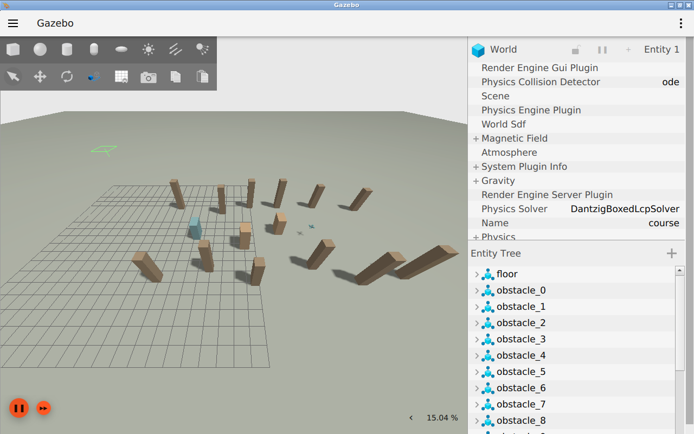

# Autonomous Drone Obstacle Avoidance Using Monocular Depth Estimation

B.Tech AI & ML Project 6

A monocular navigation pipeline using MiDaS v2.1 Small, a reactive steering policy, and a frontal safety stop. The implementation includes ROS 2 Humble and Gazebo Fortress, a portable simulator, depth benchmarks, policy optimisation, experiment tracking, and drift monitoring.

## Demonstration

- [Gazebo flight video](demo/gazebo-flight.mp4)
- [Recorded run summary](demo/midas_301.json) and [per-frame telemetry](demo/midas_301_frames.csv)
- [Final report](docs/final-report.pdf)
- [Presentation](docs/presentation.pptx)

Download and open `drone-simulation.html` in a browser to compare recorded MiDaS, ground-truth depth, and straight-line runs. The replay includes RGB frames, depth estimates, clearance, and velocity commands.



## Results

| Evaluation | Measured outcome |
| --- | --- |
| Portable simulator, MiDaS | 46/50 collision-free completions |
| Portable simulator, ground-truth depth | 50/50 collision-free completions |
| Portable simulator, straight-line baseline | 0/50 collision-free completions |
| Recorded Gazebo flight, Grove seed 301 | Goal reached in 10.41 simulated seconds, 105 control frames |
| Recorded Gazebo minimum clearance | 0.042 m |

The Gazebo demonstration ran at a target real-time factor of 0.15 on a two-core Codespace. The video plays at 1.5 times the recorded speed. The 50-course Gazebo evaluation remains open. The portable MiDaS stop-only test recorded 14 collisions in 20 runs. Detailed metrics, benchmark protocols, and limitations are in the report and `results/`.

## Browser demo with GitHub Codespaces

Create a Codespace from this repository. The development container installs the Linux dependencies. Run the following command in its terminal.

```bash
GAZEBO_START_PAUSED=1 GAZEBO_REAL_TIME_FACTOR=.15 bash ros/browser.sh 301 midas
```

Open the private forwarded port 6080 and append `/vnc.html?autoconnect=true&resize=scale`. Return to the terminal and press Enter to load Gazebo, then click its orange Play button to start the flight. The terminal displays the outcome and keeps the scene open until Enter is pressed again.

## Python setup

Use Python 3.11 or 3.12 for the portable simulator.

```bash
python -m venv .venv
python -m pip install -r requirements.txt
python -m unittest discover -s tests -v
python replay.py --serve 8765
```

Activate `.venv` before installing dependencies and running the commands. Open `http://127.0.0.1:8765`. The first model run downloads the official weights and checks SHA-256.

## Repository contents

| Location | Purpose |
| --- | --- |
| `ros/` | Gazebo world generation, ROS nodes, launchers, and batch runner |
| `demo/` | Recorded Gazebo video and matching run evidence |
| `docs/` | Report, presentation, and implementation guide |
| `results/` | Navigation, depth, latency, tuning, drift, and MLflow evidence |
| `data/raycast-rgbd-v1/` | 5,000 generated RGB-depth pairs with manifests and hashes |
| `report/` | Editable report generator and institution-specific cover metadata |
| `tests/` | Control, camera, geometry, and reproducibility checks |

See [implementation and reproduction commands](docs/implementation.md) and the [model and data card](MODEL_AND_DATA_CARD.md) for dataset provenance, metrics, and serving profiles. The project uses the published [MiDaS model](https://github.com/isl-org/MiDaS), [NYU Depth V2](https://cs.nyu.edu/~fergus/datasets/nyu_depth_v2.html), and [KITTI](https://www.cvlibs.net/datasets/kitti/). The MLflow database is an experiment snapshot. Run `python track.py --output tracking` to generate artifact links for your checkout.
